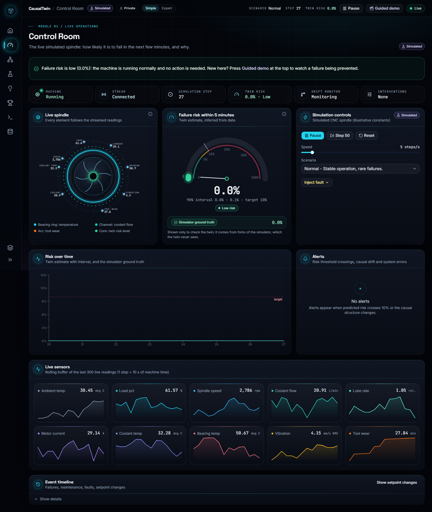
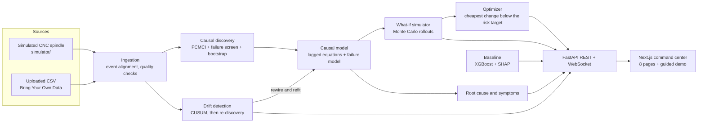

# CausalTwin

**A causal digital twin for a CNC milling spindle: it finds why the machine is failing, which
lever actually prevents it, and how much to change it, and it checks its own answers.**

Hackathon track SNH-AI-01, "CausalTwin: AI That Discovers Why a System Is Failing".

- Live demo: `[live demo link: add after deployment, see docs/DEPLOYMENT.md]`
- Demo video: `[video link: add after recording, see docs/DEMO_SCRIPT.md]`



`[GIF placeholder: a 10-second loop of the guided demo, recorded as described in docs/DEMO_SCRIPT.md]`

> **Everything shown is simulated.** The machine is a simulator we built; its physical constants are
> illustrative and plausible, not taken from a real machine datasheet. Because we built it, we know
> the true causes, which is what lets us check every claim below. Every number in this README is
> generated from result files produced by code (`backend/scripts/update_readme_results.py`).

## The problem: prediction is not understanding

Most predictive-maintenance AI answers "failure is likely". A maintenance engineer then has to guess
what to change. The usual guess comes from feature importance: whatever the model leans on most.

That guess can be badly wrong. In our spindle, **vibration rises before failures**: fast, heavily
loaded cutting with a worn tool vibrates more, and the same conditions overheat the bearing and wear
the tool, which are what actually cause failures. Vibration is a symptom. A standard model
(XGBoost + SHAP) ranks it as the top risk factor, so the standard advice is "damp the vibration",
which does nothing for the failure risk. This is the **Correlation Trap**.

CausalTwin learns the cause-and-effect structure from the sensor history, simulates what each
possible change would do, and recommends the cheapest change that actually brings the risk down.

<!-- results:headline:start -->
- **93%** of 30 simulated high-risk cases brought to 10% true failure risk or less by CausalTwin, against **3%** for a standard XGBoost + SHAP approach.
- In **22 of 30** cases the standard approach blamed vibration, which has no causal effect on failure in the simulator.
- **9 of 9** injected physical faults were detected and the causal graph rewired; median detection delay **3 steps (30 s of machine time)**.
<!-- results:headline:end -->

## What CausalTwin does

The six outputs required by the brief, where to see them, and where the code lives:

| Required output | In the app | Code |
|---|---|---|
| Working causal AI engine | Graph Explorer, System Console | `backend/causaltwin/engine/` (`discovery.py`, `causal_model.py`, `twin.py`) |
| Dynamic causal graph, continuously updated | Graph Explorer (live values, rewiring animation, version history) | `engine/`, `intelligence/drift.py`, `api/live.py` (`graph_update` messages) |
| What-if simulator | What-If Lab (`POST /whatif`) | `engine/whatif.py` |
| Intervention recommendation engine (smallest change that prevents failure) | Advisor (`GET /recommend`, `POST /apply`) | `intelligence/optimizer.py` |
| Confidence and explanation layer | Every page: "How was this computed?" drawers, confidence bars, root-cause paths, model cards | `engine/confidence.py`, `engine/root_cause.py`, `provenance` blocks in `api/schemas.py`, `frontend/src/components/transparency/` |
| Demonstration on a simulated dataset | Guided demo (top bar), Benchmark page | `simulator/`, `api/live.py` (`DemoScript`), `intelligence/benchmark.py` |

The app opens in **Simple view**: each page starts with one plain-language sentence about what it shows
(on the Control Room, what the live data means right now), and technical panels are folded behind
"Show details". **Expert view** (switch in the top bar or the sidebar) shows everything at once.

## Signature features

**1. The Correlation Trap benchmark.** Thirty high-risk moments are found in five scenarios. At each
one, CausalTwin's recommendation and the standard approach's recommendation (XGBoost + SHAP, top
feature mapped to an engineer's action) are both applied to forks of the real simulator, from the
same state with the same random seeds. The simulator judges the outcome. Every case is reported,
including the ones CausalTwin loses.

**2. Causal Drift Detection.** Machines change: a coolant filter clogs, a lubricant line leaks, a
bearing gets damaged. CausalTwin watches its own one-step prediction errors (CUSUM). When they drift,
it collects fresh data, re-runs causal discovery, shows which cause-effect links changed, rewires the
graph live, refits the affected equations, and marks earlier recommendations as outdated.

## Architecture



## How it works, step by step

1. **Ingest.** Sensor readings (one row every 10 s) and the event log (failures, maintenance, tool
   changes, setpoint changes) are aligned and quality-checked: gaps, flat lines, ranges.
2. **Discover.** PCMCI (Runge et al., 2019, via `tigramite`) tests every candidate cause at lags of 1 to
   3 steps while conditioning on all other candidates, so links that only exist through a common
   cause drop out. Rare jumps that a variable's causes cannot explain (such as tool chipping) are left
   out of that variable's test, so they cannot hide its real causes. A logistic screen on the long
   failure history finds the direct causes of failure.
   A moving-block bootstrap (20 resamples) gives every link a confidence value.
3. **Fit.** Each variable gets a linear equation in its discovered causes; failure gets a logistic
   model. Accuracy is measured on held-out data and shown on model cards.
4. **Simulate.** A what-if forces chosen variables to new values (Pearl's do-operator) and rolls the
   equations forward 200 times with resampled noise, with and without the change, using the same noise
   for both. Each rollout also draws its own failure-model coefficients from their estimated uncertainty.
   The result is the change in failure risk with an interval.
5. **Recommend.** The optimizer scores about 870 candidate changes (single levers, lever pairs, a tool
   change) in one batched pass, keeps those predicted to reach the risk target with a safety margin,
   re-checks the best five with fresh noise, and recommends the cheapest. Costs are illustrative units.
6. **Explain.** Root-cause analysis follows causal paths to failure and ranks their contributions;
   correlated variables with no causal path are listed as symptoms. Every result carries its method,
   data window, parameters, timing and assumptions.
7. **Watch for drift.** CUSUM on the equations' prediction errors flags a change; after 600 new steps
   the graph is re-discovered, compared with the old one, and rewired.
8. **Verify.** Because the machine is simulated, every claim can be checked against ground truth: the
   true graph, true risk and real outcomes of interventions. Ground truth appears only in clearly
   labelled validation views; the twin never uses it.

## Results

All results are on the simulator, judged by simulator ground truth.

### Correlation Trap benchmark

<!-- results:benchmark:start -->
| Metric | CausalTwin | XGBoost + SHAP |
|---|---|---|
| Reached the 10% target (true risk) | **28 / 30 (93%)** | 1 / 30 (3%) |
| Mean true risk after the action | 3.8% | 30.1% |
| Mean risk reduction | 26.6 points | 0.3 points |
| Failure rate within 30 steps (simulated futures) | 0.0% | 23.8% |
| Mean cost (illustrative units) | 6.6 | 2.5 |

No action: mean true risk 30.4%. Head to head: CausalTwin better in 29, tied in 1, worse in 0 case(s).
CausalTwin missed the target in 2 case(s): case 28 (tool_wear, true risk after 13.4%), case 29 (tool_wear, true risk after 11.2%).

| Scenario | Cases | CausalTwin reached target | Baseline reached target |
|---|---|---|---|
| normal | 6 | 100% | 0% |
| overload | 6 | 100% | 0% |
| cooling_failure | 6 | 100% | 17% |
| heat_wave | 6 | 100% | 0% |
| tool_wear | 6 | 67% | 0% |

What the baseline blamed (top SHAP feature): vibration 22, ambient_temp 6, lube_rate 1, tool_wear 1.

Calibration: the twin's predicted risk against the simulator's true risk in the same cases.

| Twin prediction | Mean predicted | Mean true | Mean absolute error | Truth inside the 90% interval | Correlation |
|---|---|---|---|---|---|
| Risk with no action | 30.8% | 30.4% | 4.1 points | 87% | 0.96 |
| Risk after its own action | 3.5% | 3.8% | 1.1 points | 43% | 0.97 |

Settings: 6 situations per scenario, 8 seeds each, 30-step horizon; benchmark run took 58 s.
<!-- results:benchmark:end -->

### Causal graph recovery (against the simulator's true graph)

<!-- results:graph:start -->
| Metric | With the failure edges | Between sensors and levers only |
|---|---|---|
| True edges | 15 | 13 |
| Edges found (correct) | 15 (15) | 13 (13) |
| Precision | 1.00 | 1.00 |
| Recall | 1.00 | 1.00 |
| F1 | 1.00 | 1.00 |
| Lag accuracy (correct edges) | 1.00 | 1.00 |
| Structural Hamming distance | 0 | 0 |

Missed: none. Extra (false) edges: none.
Trap check: discovered failure causes bearing_temp, tool_wear; vibration is not a discovered cause (failure-screen p = 0.93) although its correlation with failure is +0.25; predicted risk change when vibration is halved: 0.000.
<!-- results:graph:end -->

### Intervention accuracy and equation fit

<!-- results:intervention:start -->
20 random lever changes, 8 seeds each, 30-step horizon, judged against the real simulator:

| Prediction | Result |
|---|---|
| Bearing temperature: direction of change correct | 18 / 19 |
| Bearing temperature: mean absolute error at the horizon end | 1.26 deg C (true changes average 2.93 deg C) |
| Failure risk: direction of change correct | 9 / 9 |
| Failure risk: mean absolute error | 0.57 points (true changes average 1.56 points) |

| Fitted equation | Held-out accuracy |
|---|---|
| motor_current (linear) | R2 0.926 |
| coolant_temp (linear) | R2 0.922 |
| bearing_temp (linear) | R2 0.993 |
| vibration (linear) | R2 0.987 |
| tool_wear (linear) | R2 0.999 |
| failure (logistic) | AUC 0.961 |
<!-- results:intervention:end -->

### Drift detection

<!-- results:drift:start -->
Each fault is injected at step 3,000 of an otherwise normal run (1 step = 10 s).

| Fault | Seed | Detected after | Graph rewired after | Status |
|---|---|---|---|---|
| coolant_filter_clog | 11 | 2 steps (20 s) | 602 steps | confirmed |
| coolant_filter_clog | 12 | 4 steps (40 s) | 604 steps | confirmed |
| coolant_filter_clog | 13 | 3 steps (30 s) | 603 steps | confirmed |
| lube_leak | 11 | 3 steps (30 s) | 603 steps | confirmed |
| lube_leak | 12 | 3 steps (30 s) | 603 steps | confirmed |
| lube_leak | 13 | 3 steps (30 s) | 603 steps | confirmed |
| bearing_damage | 11 | 3 steps (30 s) | 603 steps | confirmed |
| bearing_damage | 12 | 3 steps (30 s) | 1210 steps | confirmed |
| bearing_damage | 13 | 3 steps (30 s) | 603 steps | confirmed |

Fault-free runs: 60,000 steps, 5 suspected alarms, 0 wrongly confirmed structural changes. Rewiring waits for 600 post-change steps of data before re-discovery.
<!-- results:drift:end -->

### Timings against the performance budget

<!-- results:timings:start -->
| Operation | Median | Slowest run | Budget | Within budget |
|---|---|---|---|---|
| Simulate 20,000 steps | 1.51 s | 1.91 s | 2.00 s | yes |
| Causal discovery on one 3,000-step window | 2.34 s | 3.06 s | 3.00 s | yes |
| Fit the causal model | 424 ms | 450 ms | 1.00 s | yes |
| One what-if simulation (200 rollouts) | 39 ms | 50 ms | 200 ms | yes |
| Recommendation search | 488 ms | 560 ms | 1.00 s | yes |
| Baseline XGBoost training | 1.81 s | 1.83 s | 10.00 s | yes |
| Full benchmark (30 cases) | 56.96 s | 56.96 s | 60.00 s | yes |

Measured 2026-11-15 on Windows (16 logical CPUs, Python 3.11.16) by `scripts/measure_timings.py`. Laptop timings vary up to about 3x with CPU throttling (see the Phase 2 report).
<!-- results:timings:end -->

### Third-party data: the AI4I 2020 dataset

The AI4I 2020 Predictive Maintenance Dataset (UCI, CC BY 4.0) is synthetic data modelled on a real
milling machine, published with the exact rules behind each failure mode; those rules reproduce its
labels on every row, so they can judge recommendations. CausalTwin analysed it through the Bring Your
Own Data path (tabular mode, with the physics features the documentation describes), recommended the
smallest change for every failed row, and was compared with XGBoost + SHAP on the same rows.

<!-- results:ai4i:start -->
<!-- results:ai4i:end -->

What this shows, honestly: causal discovery found exactly the documented mechanism (failure caused by
the temperature difference, mechanical power and tool wear times torque, each built from the right
inputs). But CausalTwin's failure model is linear in its causes, and these failure rules are
thresholds: power must stay inside a window, and heat-dissipation failures need a speed above a limit.
A linear model only knows "less power is safer", so its advice fails on low-power and heat-dissipation
failures, where the tree-based baseline does better. A non-linear failure model is the next step
(see Limitations).

### Many simultaneous viewers

<!-- results:load:start -->
25 simulated viewers for 65 s, each like a browser tab with its own session id (live stream open, status polled every 3 s, occasional what-ifs and recommendations), against one backend process on the development laptop, allowing 4 private simulations:

| Request | Count | Median | 95th percentile | Outcomes |
|---|---|---|---|---|
| GET /metrics | 460 | 61 ms | 274 ms | 200: 460 |
| GET /recommend | 32 | 2.81 s | 4.66 s | 200: 20, 503: 12 |
| POST /whatif | 33 | 149 ms | 549 ms | 200: 17, 503: 16 |

503 means "busy, retry": at most two heavy computations run at once by design. Live stream: 3.9 messages per viewer per second, 0 failed connections. 4 viewers got a private simulation, which ran at 1.44 to 1.48 steps per second; the other 21 shared one simulation, which ran at 1.4 steps per second (target 5 each): the simulations share the CPU with each other and with the heavy requests.
<!-- results:load:end -->

Refresh these tables after re-running the experiments:

```bash
cd backend
python scripts/run_validation.py          # graph recovery, intervention accuracy, model cards
python scripts/run_benchmark.py --drift   # benchmark, calibration and drift results
python scripts/run_ai4i.py                # the AI4I 2020 check
python scripts/measure_timings.py         # timings (stop the API server first)
python scripts/load_test.py               # load test (against a running server)
python scripts/update_readme_results.py   # rewrite the tables in README.md and docs/
```

## Limitations and assumptions

- **Simulated machine.** The spindle, its physics and its costs are illustrative. Nothing here has been
  validated on a real machine.
- **No hidden confounders.** PCMCI assumes every common cause of two measured variables is itself
  measured (causal sufficiency). An unmeasured common cause can create a false link.
- **Linear, lagged effects.** Equations are linear in their causes with lags of 1 to 3 steps; real
  machines have non-linear effects and thresholds. The AI4I check above shows the cost: where failures
  follow threshold rules, the linear failure model gives poor advice.
- **Stable structure within a window.** Discovery assumes the structure does not change inside the
  analysed window; drift detection handles changes between windows, with a 600-step delay to rewire.
- **What-if holds untouched levers constant.** If an operator changes them during the horizon, the
  prediction can be wrong; the Phase 2 report documents such a case.
- **Intervals include the failure model's coefficient uncertainty but not the linear equations'**, and
  after an action they are too narrow: the benchmark's calibration table shows how often the true risk
  falls inside them.
- **Risk estimates are calibrated on average but not everywhere.** Across the benchmark cases the mean
  predicted risk matches the true risk closely (calibration table), but in extreme states at the edge of
  the training data, such as the demo's hot afternoon, the twin's estimate can be well below the ground
  truth. The cause, measured: the failure model is estimated from about 90 failures; fits on other
  60,000-step histories over- or under-estimate the same state by tens of percent. A longer history was
  tried and is not used: it improved some results but worsened calibration and caused false drift
  confirmations (Phase 6 report).
- **Costs are illustrative units, not money**, and the benchmark covers this one simulator.

What changes for a real deployment: the ground-truth checks disappear (there is no simulator to compare
against), so recommendations become hypotheses to confirm with small, safe trial changes; the levers
must have varied in the history; enough failure events are needed (the failure model refuses to fit
with fewer than 15); and the assumptions above must be reviewed with the machine's engineers.

## Real-world use

**Bring Your Own Data (works today).** On the Data page, upload a CSV from any machine, mark each column
as a control lever, sensor, environment variable or failure outcome, and CausalTwin runs discovery and
fits the equations. It shows the discovered graph and model cards, and states clearly that no ground
truth exists for uploaded data. Limits: 20 MB, 50,000 rows, 40 columns.

**Connecting a real machine (built; tested against a stand-in agent, not a real machine).** The live
loop reads rows through one small interface (`backend/causaltwin/connectors/`), so the simulator can be
replaced by:

- **MTConnect** (`CAUSALTWIN_DATA_SOURCE=mtconnect`): the read-only HTTP/XML standard many CNC machines
  expose. The backend polls the agent's `/current` once per step (10 s) and maps data items to model
  variables with `CAUSALTWIN_TAG_MAP`. It is tested end to end against `scripts/fake_mtconnect_agent.py`,
  a stand-in agent that serves simulator values (a test tool; no real machine was available).
- **Log replay** (`CAUSALTWIN_DATA_SOURCE=replay`): streams a recorded CSV as if it were live.

With a non-simulator source the app says so everywhere (a "Live data" badge instead of "Simulated"),
there is no ground truth, fault injection, scenarios and the guided demo are switched off, and
recommendations are advisory: shown to an engineer, never written to the machine. Before using a real
machine, the twin must be trained on that machine's own history (Bring Your Own Data) and its tags
mapped; OPC UA, MQTT and historian connectors would follow the same interface.

**Who it is for.** Small and medium manufacturers that cannot afford trial-and-error experiments on
production machines. Unplanned downtime is costly for them `[source needed]`; the cost of a failed
spindle or a scrapped batch `[source needed]`.

## Scalability

Measured today: one backend process serves many viewers (see "Many simultaneous viewers" above) and
the container runs within 512 MB (docs/DEPLOYMENT.md).

**One simulation per viewer (built).** Each browser tab sends a random session id
(`frontend/src/lib/session.ts`), and the backend gives each id its own live simulation, guided demo,
live stream and console log (`backend/causaltwin/api/sessions.py`). One judge's Reset, fault injection or
demo therefore never changes what another judge sees. Watched simulations share the CPU of one
process: on the development laptop each ran at about 3.8 steps per second alone, 2.9 with two and 2.0
with four watched at once (target 5), and about 1.4 under the heavy 25-viewer load above. Their number is
therefore limited: `CAUSALTWIN_MAX_SESSIONS`, 4 by default and 2 on Render's free plan. A simulation
steps only while someone watches it; a private one is replaced when all slots are taken and nobody has
watched it for 30 seconds, and is deleted after 10 unwatched minutes. Viewers beyond the limit share one simulation, and the top bar
says "Shared" instead of "Private", with the reason. Scripts and health checks without a session id use
that shared simulation too. With a real machine (MTConnect) there is one machine, so all viewers share
its live view.

The demo still runs one twin of one machine; scaling to a factory would follow this design (not built
yet):

- **One twin per machine.** Each twin is small: its fitted model is a handful of linear equations plus a
  logistic model, and a risk estimate takes milliseconds. Many twins fit on one server.
- **Discovery only when needed.** Full causal discovery (the expensive step, a few seconds per window; see
  the timings table) runs at commissioning and after a drift alert, not continuously. Between alerts each twin only does
  cheap prediction and CUSUM checks.
- **Incremental fitting.** After drift, only the equations whose causes changed are refitted (already
  how rewiring works).
- **Horizontal scaling of the API.** The API is stateless apart from the live twin; twins would move to
  worker processes keyed by machine id, with a message bus carrying sensor data in and alerts out.
- **Shared knowledge.** Machines of the same model could start from a shared graph and adapt it, cutting
  the history each new machine needs.

## Running it

**One command** (Docker Desktop or Docker Engine with Compose):

```bash
docker compose up --build
```

Open http://localhost:3000. The API is at http://localhost:8000 (documentation at `/docs`). The first
build installs the dependencies and trains the models inside the image, which takes several minutes.
Settings: copy `.env.example` to `.env`.

**Manual setup** (Python 3.11, Node.js 20.9 or newer):

```bash
# Backend
cd backend
python3.11 -m venv .venv
.venv/Scripts/activate                # Windows; use: source .venv/bin/activate on Linux/macOS
pip install -r requirements-dev.txt
uvicorn causaltwin.api.app:app --port 8000      # first start trains and caches the models (about 30 s)

# Frontend (second terminal)
cd frontend
npm install
npm run dev                           # or: npm run build && npm run start
```

**Tests and checks:**

```bash
cd backend && python -m pytest -q && python -m ruff check . && python -m mypy causaltwin tests
cd frontend && npm run lint && npx tsc --noEmit && npm run build
cd frontend && npm run test:e2e       # end-to-end tests against running servers (Playwright)
```

Deployment (Render for the backend, Vercel for the frontend): see [docs/DEPLOYMENT.md](docs/DEPLOYMENT.md).

## Project documents

- Phase reports: [1](docs/phase_1_report.md), [2](docs/phase_2_report.md), [3](docs/phase_3_report.md), [4](docs/phase_4_report.md), [5](docs/phase_5_report.md)
- [Demo script](docs/DEMO_SCRIPT.md), [slides outline](docs/SLIDES_OUTLINE.md), [judge Q&A](docs/JUDGE_QA.md), [final audit](docs/FINAL_AUDIT.md), [deployment](docs/DEPLOYMENT.md)

## Tech stack

- **Backend:** Python 3.11, NumPy, pandas, SciPy, scikit-learn, tigramite (PCMCI), statsmodels, XGBoost and
  SHAP (baseline only), FastAPI, Uvicorn, Pydantic, pytest.
- **Frontend:** Next.js (App Router) with TypeScript, Tailwind CSS, shadcn/ui, React Flow, Recharts, Zustand,
  Framer Motion, Playwright.
- **Deployment:** Docker, Render (backend with WebSockets), Vercel (frontend).

No GPU and no deep learning: every model trains in seconds on a laptop CPU.

## Credits and citations

- J. Runge, P. Nowack, M. Kretschmer, S. Flaxman, D. Sejdinovic (2019). Detecting and quantifying causal
  associations in large nonlinear time series datasets. *Science Advances* 5(11), eaau4996. (PCMCI)
- J. Runge (2020). Discovering contemporaneous and lagged causal relations in autocorrelated nonlinear
  time series datasets. *Proceedings of UAI 2020*. (PCMCI+, used for tabular uploads)
- `tigramite`, the reference implementation of PCMCI by Jakob Runge and contributors (GPL-3.0):
  https://github.com/jakobrunge/tigramite
- T. Chen, C. Guestrin (2016). XGBoost: A Scalable Tree Boosting System. *KDD 2016*.
- S. M. Lundberg, S.-I. Lee (2017). A Unified Approach to Interpreting Model Predictions. *NeurIPS 2017*. (SHAP)
- S. M. Lundberg et al. (2020). From local explanations to global understanding with explainable AI for
  trees. *Nature Machine Intelligence* 2, 56-67. (TreeExplainer)
- E. S. Page (1954). Continuous inspection schemes. *Biometrika* 41(1/2), 100-115. (CUSUM)
- H. R. Künsch (1989). The jackknife and the bootstrap for general stationary observations.
  *Annals of Statistics* 17(3), 1217-1241. (moving-block bootstrap)
- S. Matzka (2020). Explainable Artificial Intelligence for Predictive Maintenance Applications. *Third
  International Conference on Artificial Intelligence for Industries (AI4I)*, 91-95. The AI4I 2020
  Predictive Maintenance Dataset, UCI Machine Learning Repository, CC BY 4.0, DOI 10.24432/C5HS5C
  (included in `backend/data/external/` with its attribution).

## License

GPL-3.0, to stay compatible with `tigramite`. See [LICENSE](LICENSE).
